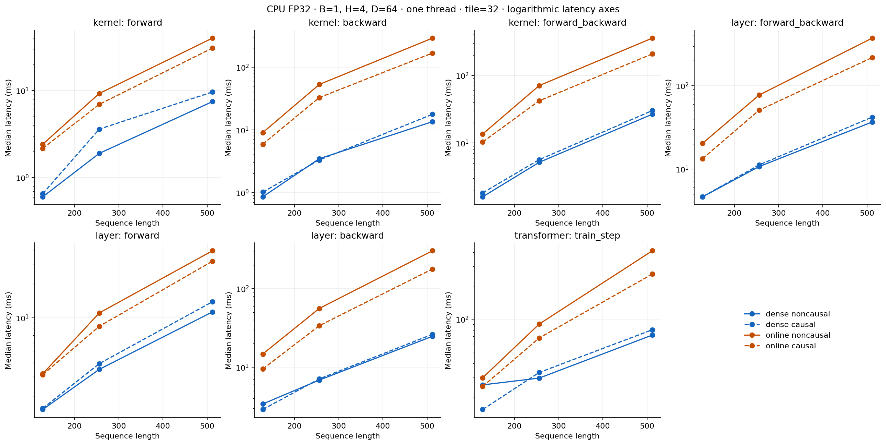
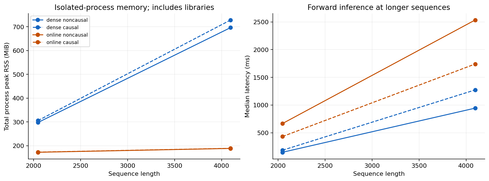
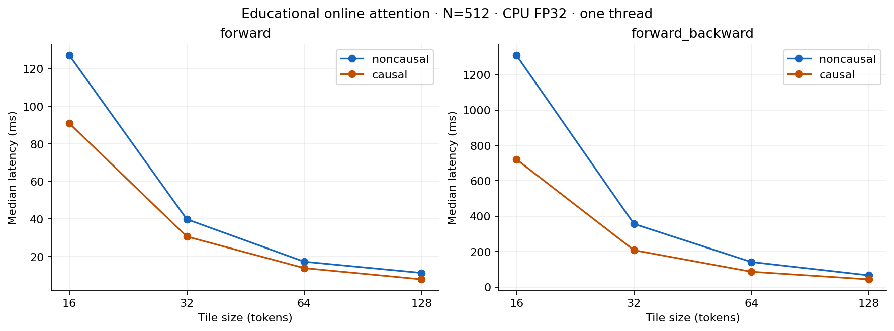

# Extended benchmark results

Measured on Intel Core i5-5257U @ 2.70GHz, 8.0 GiB RAM; macOS-12.7.6-x86_64-i386-64bit.
Python 3.9.6, PyTorch 2.2.2, CPU FP32, 1 CPU thread(s), seed 17.
B=1, H=4, D=64; tile=32 unless noted. Both masking modes were measured.

All six correctness tests passed; see [test output](test_results.txt).
All experiment rows passed finite-output/gradient checks. FlashAttention did not execute.

## Latency at N=512

Median milliseconds; five warmups and twenty measured repetitions.

| Workload | Mask | Dense | Online | Online / dense |
| --- | --- | ---: | ---: | ---: |
| kernel/forward | noncausal | 7.449 | 39.866 | 5.35x |
| kernel/forward | causal | 9.610 | 30.668 | 3.19x |
| kernel/backward | noncausal | 13.467 | 289.213 | 21.48x |
| kernel/backward | causal | 17.665 | 167.132 | 9.46x |
| kernel/forward_backward | noncausal | 26.591 | 356.604 | 13.41x |
| kernel/forward_backward | causal | 30.144 | 208.117 | 6.90x |
| layer/forward_backward | noncausal | 36.725 | 374.503 | 10.20x |
| layer/forward_backward | causal | 42.037 | 218.891 | 5.21x |
| layer/forward | noncausal | 11.255 | 39.228 | 3.49x |
| layer/forward | causal | 13.852 | 31.714 | 2.29x |
| layer/backward | noncausal | 24.746 | 302.398 | 12.22x |
| layer/backward | causal | 26.220 | 177.428 | 6.77x |
| transformer/train_step | noncausal | 71.999 | 413.371 | 5.74x |
| transformer/train_step | causal | 80.394 | 255.096 | 3.17x |

The ratio is latency, so values above 1 mean online was slower.
Backward-only excludes building the fresh forward graph and clearing gradients.
Forward-plus-backward includes graph construction, but excludes clearing gradients.
Transformer train_step includes zero_grad, forward, MSE, backward and SGD.

## Larger forward-only memory cases

One warmup and five repetitions. Peak RSS includes the complete isolated process;
it is not incremental tensor allocation. No backward graphs are built.

| N | Mask | Method | Median ms | Total peak RSS MiB |
| ---: | --- | --- | ---: | ---: |
| 2048 | noncausal | dense | 147.528 | 297.6 |
| 2048 | noncausal | online | 666.634 | 172.5 |
| 2048 | causal | dense | 184.553 | 305.6 |
| 2048 | causal | online | 432.108 | 173.0 |
| 4096 | noncausal | dense | 943.720 | 696.1 |
| 4096 | noncausal | online | 2534.508 | 188.6 |
| 4096 | causal | dense | 1272.306 | 728.1 |
| 4096 | causal | online | 1740.057 | 189.0 |

## Tile-size sweep

N=512, online kernel; tile sizes 16, 32, 64 and 128. Five warmups, twenty samples.
Larger tiles reduce Python-loop and separate-operation overhead in this implementation.
They can also increase temporary memory. This experiment is not a fused GPU kernel benchmark.

| Tile | Mask | Forward ms | Forward + backward ms |
| ---: | --- | ---: | ---: |
| 16 | noncausal | 127.006 | 1308.485 |
| 16 | causal | 90.828 | 720.845 |
| 32 | noncausal | 39.866 | 356.604 |
| 32 | causal | 30.668 | 208.117 |
| 64 | noncausal | 17.290 | 141.409 |
| 64 | causal | 13.895 | 86.228 |
| 128 | noncausal | 11.319 | 65.998 |
| 128 | causal | 7.901 | 43.255 |

## Synthetic training checks

One Transformer block with 4x feed-forward width, fixed random features and targets,
MSE and SGD at lr=0.01. Losses below span five warmup plus twenty timed updates.
This measures step cost and numerical behavior, not model quality or convergence.

| N | Mask | Method | Initial MSE | Final MSE |
| ---: | --- | --- | ---: | ---: |
| 128 | noncausal | dense | 2.037156 | 2.025074 |
| 128 | noncausal | online | 2.037156 | 2.025074 |
| 128 | causal | dense | 2.043089 | 2.030325 |
| 128 | causal | online | 2.043089 | 2.030325 |
| 256 | noncausal | dense | 2.037371 | 2.030226 |
| 256 | noncausal | online | 2.037371 | 2.030226 |
| 256 | causal | dense | 2.039968 | 2.032558 |
| 256 | causal | online | 2.039968 | 2.032558 |
| 512 | noncausal | dense | 2.032365 | 2.027679 |
| 512 | noncausal | online | 2.032365 | 2.027679 |
| 512 | causal | dense | 2.033694 | 2.028924 |
| 512 | causal | online | 2.033694 | 2.028924 |

## Reproducibility and limits

- Raw samples: `extended_results.json`, `memory_results.json`, `tile_*_results.json`.
- Flat measurements: `results.csv`; charts also exported as SVG.
- Runtime/build details: `hardware.json`; dependencies: `environment.lock.txt`.
- Test output: `test_results.txt`; commands and timing definitions: `README.md`.
- CPU allocations are retained by allocators; process peak memory includes libraries.
- Separate-process startup is excluded from latency but included in peak RSS.
- Twenty samples describe this run, not confidence intervals across independent runs.
- Python tiling adds overhead and retains tile graphs during training.
- No supported GPU is available; no FlashAttention speedup or GPU memory result is claimed.
- These PyTorch results cannot be compared directly with the earlier Ruby FP64 demonstration.
